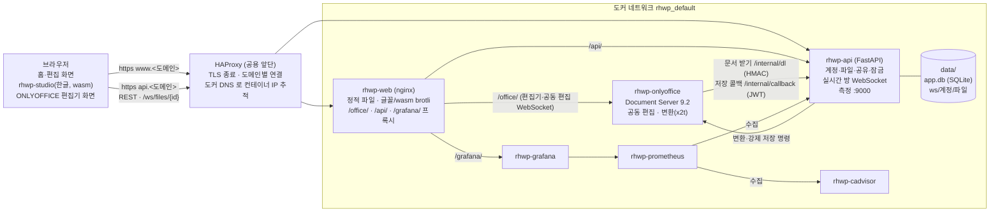

# 알오피스 (rhwp office)

웹 워드·엑셀·파워포인트 + 한글(HWP/HWPX) 편집 사이트.

이전 오프라인 앱은 Git 태그 `archive/app-ubuntu`, `archive/app-windows`, `archive/app-android`, `archive/local-mode`와 [GitHub 릴리스](https://github.com/creepereye1204/myoffice/releases)에 보관되어 있다.

- `www.<도메인>` — 프론트 (`rhwp-web`, nginx)
  - `/rhwp/` rhwp-studio (HWP 편집기, edwardkim/rhwp v0.9.1 빌드 미러, MIT)
  - `/office/` ONLYOFFICE Document Server 프록시
  - `/api/` API 같은 출처 프록시
- `api.<도메인>` — API (`rhwp-api`, FastAPI)
- `rhwp-onlyoffice` — ONLYOFFICE 9.2 + 나눔/Noto CJK 글꼴, JWT 사용

## 기능
- 새로 만들기: 워드·엑셀·파워포인트 (MS Office), 한글·한셀·한쇼 (한컴오피스 — 한셀/한쇼는 xlsx/pptx로 만들어 한셀·한쇼에서 바로 열림)
- 계정: 회원가입/로그인, 관리자 페이지(`/admin` — 사용자 목록, 사용 중지, 비밀번호 재설정, 삭제, 가입 열고 닫기)
- 공유: 특정 사용자(아이디)에게 보기/편집 권한, 또는 링크(로그인 없이 보기/편집)
- 실시간 공동 편집
  - Office 문서: ONLYOFFICE 자체 WebSocket으로 글자 단위 동시 편집
  - 한글: 한 명씩 편집(잠금) + 나머지는 저장될 때마다 실시간 갱신, "편집 요청 → 넘기기"
  - 편집자 연결이 잠깐 끊겨도 10초간 잠금 유지, 창을 닫으면 바로 넘김
  - 접속자 표시·이름 변경 알림은 API의 WebSocket(`/ws/files/{id}`)
- 저장
  - 자동 저장: Office는 30초마다 강제 저장, 한글은 수정 멈추고 5초 뒤
  - Ctrl+S: 어디서 눌러도 브라우저 저장 창 대신 서버 저장, 실제 저장이 확인된 뒤에만 "저장했습니다"
- PDF: 편집기의 PDF 버튼 / 홈 메뉴 "PDF로 다운로드", 형식 변환 사본(HWP→DOCX 등)

## 아키텍처



| 구성 요소 | 하는 일 |
|---|---|
| 브라우저 | 홈(`index.html`·`home.js`)과 편집(`edit.html`·`edit.js`) 화면. 한글은 **rhwp-studio**(wasm)가 브라우저 안에서 읽고 쓴다. 워드·엑셀·파워포인트(한셀·한쇼 포함)는 ONLYOFFICE 편집기 화면이 iframe 으로 뜬다. `rum.js` 가 요청 구간별 시간을 API 로 보낸다. |
| HAProxy | 서버의 여러 프로젝트가 같이 쓰는 앞단. TLS 인증서, 도메인별 백엔드 연결. 도커 DNS 로 컨테이너 IP 를 따라가서 재배포 후 재시작이 필요 없다. |
| rhwp-web (nginx) | 정적 파일(화면, rhwp-studio, 글꼴, wasm — 미리 brotli 압축, 30일 캐시). 같은 출처 프록시: `/office/` → ONLYOFFICE, `/api/` → API, `/grafana/` → Grafana. |
| rhwp-api (FastAPI) | 계정·세션, 파일 저장·버전, 공유(사용자 지정·링크), 한글 편집 잠금, 실시간 방(`/ws/files/{id}`: 접속자, 잠금, 저장 알림, 마우스·드래그·선택 표시), ONLYOFFICE 설정 발급과 저장 콜백, 변환·PDF. 측정값은 내부 포트 9000 에서만. |
| rhwp-onlyoffice | ONLYOFFICE Document Server Community 9.2. 워드·엑셀·파워포인트 편집 화면, 글자 단위 공동 편집, 30초 강제 저장, 형식 변환(x2t). |
| data/ | `app.db`(계정·세션·공유) + `ws/<계정>/<파일 id>/`(파일 본문, `meta.json`). 컨테이너 밖 서버 디스크라 재배포해도 남는다. |
| 모니터링 | Prometheus(API·cAdvisor 수집, 30일 보관) → Grafana 대시보드 "알오피스 — 요청 구간". |

**주요 흐름**
1. **한글 문서 열기·저장:** 브라우저가 `GET /api/files/{id}/content` 로 받아 rhwp-studio 에서 연다 → 수정 후 5초 쉬면(또는 Ctrl+S) 브라우저가 `exportHwp/exportHwpx` → `PUT /api/files/{id}/content` (편집 잠금·버전 확인). 같은 문서를 보는 다른 사람은 실시간 방의 "저장됨" 알림을 받고 새 내용으로 다시 연다.
2. **워드·엑셀·파워포인트 열기·저장:** 브라우저가 `GET /api/files/{id}/onlyoffice` 로 편집기 설정(JWT 서명)을 받아 ONLYOFFICE 편집기를 띄운다 → ONLYOFFICE 가 API 의 `/internal/dl`(HMAC 서명 주소)로 파일을 받는다 → 편집 내용은 ONLYOFFICE 끼리 WebSocket 으로 공동 편집 → 30초마다 또는 Ctrl+S 때 ONLYOFFICE 가 `/internal/callback` 으로 결과 파일을 보내면 API 가 저장하고 실시간 방에 알린다.
3. **공유:** 사용자 지정(아이디별 보기/편집) 또는 링크(`/edit?s=<토큰>`, 로그인 없이). API 가 요청마다 권한을 확인한다.
4. **변환·PDF:** API 가 ONLYOFFICE ConversionService 에 변환을 맡긴다 (한글 → 워드/PDF 포함).

## 구조
- 인증: `POST /api/auth/login` → 세션 토큰을 `Authorization: Bearer` 로. DB는 `data/app.db`(SQLite, 비밀번호 scrypt, 토큰은 해시만 저장)
- 관리자: 첫 실행 때 `.env`의 `ADMIN_USERNAME`/`ADMIN_PASSWORD`로 생성.
- 파일: `data/ws/<계정 폴더>/<id>/`. 한도: 파일 50MB, 계정당 500MB/300개 (compose env).
- Office 파일: ONLYOFFICE가 `http://api:8000/internal/dl/...`(HMAC 서명)로 받고, 저장은 `/internal/callback/...`(서명 + JWT).
- HWP 파일: 브라우저의 rhwp 편집기가 `exportHwp/exportHwpx` → `PUT /api/files/{id}/content` (잠금 + 버전 확인).
- 변환/PDF: ONLYOFFICE ConversionService.
- 로딩 속도: 빌드 때 HWP 글꼴을 같은 출처로 내려받아 TTF로 풀고 brotli 미리 압축(woff2 풀기 시간 제거), wasm도 brotli, 홈 화면에서 유휴 시간에 HWP·ONLYOFFICE 편집기 미리 받기.
- 리버스 프록시(앞단): 실제 IP 전달(`X-Forwarded-For`, 가입·로그인 시도 제한용)과 긴 WebSocket 타임아웃이 필요.
- 비밀값: `.env` (JWT_SECRET, SIGN_SECRET, ADMIN_PASSWORD) — 커밋 금지.

## 실행
```bash
cp .env.example .env   # 값 채우기 (openssl rand -hex 32)
mkdir -p data && chmod 777 data
docker compose up -d --build
```
- 컨테이너는 호스트 포트를 열지 않는다. 앞단 리버스 프록시가 `rhwp_default` 네트워크로 `rhwp-web:80`, `rhwp-api:8000`에 연결.
- 도메인은 코드에 넣지 않는다: 프론트는 `www.X` → `api.X`, ONLYOFFICE는 같은 출처 `/office/`. CORS만 compose의 `CORS_ORIGINS`로 설정.

## 모니터링
- [Grafana](https://www.myoffice.p-e.kr/grafana/)에서 `admin`과 `.env`의 `GRAFANA_ADMIN_PASSWORD`로 처음 로그인한다. 실행 전에 비밀번호를 설정한다.
- 브라우저 패널은 리소스 종류별 DNS·TCP·TLS·응답 대기(TTFB)·다운로드 시간의 p50/p95, 전체 시간, 전송량과 캐시 적중률을 보여 준다. `page`에서 홈과 편집 화면을 선택할 수 있다.
- API 패널은 라우트별 응답 헤더까지 걸린 p95 시간, 초당 요청 수, 수신 및 응답 바이트를 보여 준다. ONLYOFFICE 패널에는 변환과 강제 저장 시간이 표시된다.
- 컨테이너 패널은 웹·API·ONLYOFFICE의 네트워크 송수신량과 컨테이너별 CPU·메모리 사용량을 보여 준다.
- Prometheus는 30일간 메트릭을 보관한다. API 메트릭 포트 `9000`은 도커 네트워크 내부에서만 사용한다.

## 테스트
```bash
WEB_URL=https://www.<도메인> API_URL=https://api.<도메인> tests/run-api-tests.sh   # API (pytest, 도커 안에서)
WEB_URL=https://www.<도메인> API_URL=https://api.<도메인> tests/e2e/run.sh         # 브라우저 E2E (Playwright)
```
관리자 비밀번호는 `.env`에서 읽어 테스트 계정을 만들고, 끝나면 지운다.

## rhwp-studio 업데이트
`frontend/public/rhwp/`는 https://edwardkim.github.io/rhwp/ 빌드를 sw.js precache 목록 + wasm 2개로 미러한 것.
버전을 올리려면 같은 방식으로 다시 받고 `frontend/public/vendor/rhwp-editor/`(npm @rhwp/editor)도 같은 버전으로 맞춘다.

## 서드파티
- `frontend/public/rhwp/`, `frontend/public/vendor/rhwp-editor/` — [edwardkim/rhwp](https://github.com/edwardkim/rhwp) (MIT). 포함 글꼴은 각 글꼴 라이선스를 따른다.
- ONLYOFFICE Document Server — AGPL-3.0 (공식 도커 이미지를 그대로 사용).

## 에러 로그

- 브라우저는 운영 호스트에서 JavaScript 예외, 처리되지 않은 Promise 거부, API 5xx·네트워크 오류, 오류 토스트, 편집기 열기·저장 오류를 모읍니다. 같은 페이지에서 반복되는 오류는 한 번만 보내며 페이지당 최대 20건을 보냅니다. 빌드는 웹 문서의 수정 시각으로 표시합니다.
- API는 처리되지 않은 예외, 5xx 응답, ONLYOFFICE 콜백·변환 실패를 기록합니다. API 응답의 `X-Request-ID`로 브라우저와 서버 로그를 찾을 수 있습니다. 계정 ID는 API가 인증한 경우에만 로그에 남깁니다.
- 수집기는 오류 진단 필드만 전송합니다. 요청·응답 본문, 문서 내용, 제목, 파일 이름, 파일 ID, 공유 토큰, 이메일, URL 쿼리는 수집 대상에서 제외하며 오류 메시지와 스택에서도 식별 정보를 제거합니다.
- UTC 일자별 JSONL은 API 컨테이너의 `/data/logs/` (호스트의 `data/logs/`)에 저장됩니다. 파일 이름은 `client-errors-YYYY-MM-DD.jsonl`과 `server-errors-YYYY-MM-DD.jsonl`입니다. Grafana의 `/grafana/`에서 **알오피스 — 에러** 대시보드를 열면 Loki에 수집된 오류 추이와 최근 로그를 볼 수 있습니다. 로그 보존 기간은 30일입니다.
- 저장된 로그 요약은 저장소에서 `python3 tools/errors_report.py --days 7`로 확인합니다. 다른 디렉터리는 `--log-dir`로 지정합니다.
